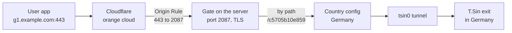

<div dir="rtl">

# راهنمای T.Sin در پنل Next

نسخه `v1.37.0` · کشورهای خروجی T.Sin

هر چیزی که برای فروش کشورهای T.Sin لازم داری: چه چیزهایی در این نسخه اضافه شده، نصب از صفر، آپدیت، و راه‌اندازی همه کشورها روی یک دامنه و پورت ۴۴۳.

- [چه چیزهایی جدید است](#چه-چیزهایی-جدید-است)
- [نگهبان تونل دقیقاً چه می‌کند](#نگهبان-تونل-دقیقاً-چه-میکند)
- [نصب از اول](#نصب-از-اول)
- [آموزش حالت path روی پورت ۴۴۳](#آموزش-حالت-path-روی-پورت-۴۴۳)
- [آپدیت برای کسانی که پنل را از قبل دارند](#آپدیت-برای-کسانی-که-پنل-را-از-قبل-دارند)
- [رفع مشکل](#رفع-مشکل)

## چه چیزهایی جدید است

کارهایی که برنامه خود T.Sin (یعنی T.Sin Pro) روی سرور انجام می‌دهد، حالا داخل خود پنل است. لازم نیست آن برنامه جداگانه نصب شود.

| قابلیت | چه می‌کند | کجاست |
|---|---|---|
| **پیدا کردن بهترین دیتاسنتر** | هم‌زمان از هر پنج دیتاسنتر (dc1 تا dc5) می‌پرسد، کنار هر کدام سرعت جواب و تعداد کشورها را نشان می‌دهد و سریع‌ترینی را که توکن را قبول می‌کند انتخاب می‌کند. | سرویس‌ها ← Tools ← Countries ← «Find the best» |
| **نگهبان تونل روی سرور پنل** | هر دقیقه تونل را چک می‌کند و اگر قطع بود، خودش تعمیرش می‌کند. به تونل سالم و به کانفیگ‌ها هیچ‌وقت دست نمی‌زند. | خودکار، بدون تنظیم |
| **نگهبان تونل روی نود** | اسکریپت نود حالا علاوه بر ساخت تونل، همین نگهبان را روی خود نود هم نصب می‌کند. | با یک بار اجرای اسکریپت نود |
| **مراقبت از اکانت T.Sin** | هر ۳۰ دقیقه اکانت را چک می‌کند و قبل از قطع شدن کشورها در تلگرام خبر می‌دهد: حجم ۹۰٪، انقضای نزدیک، اکانت غیرفعال، یا کشوری که دیگر در اکانت نیست. | تنظیمات ← تلگرام ← رویداد «تونل T.Sin» |
| **عوض کردن دیتاسنتر بدون خطا** | قبل از رفتن به دیتاسنتر جدید، پنل اول از دیتاسنتر قبلی خارج می‌شود تا T.Sin خطای «توکن جای دیگری در حال استفاده است» ندهد. | موقع «Apply» |
| **WireGuard همراه نصب پنل** | در نصب جدید، WireGuard هم نصب می‌شود و برای فعال کردن کشورها فقط توکن لازم است. اگر نصب WireGuard به خطا بخورد، نصب پنل متوقف نمی‌شود. | نصب جدید |

> [!NOTE]
> **لینک کاربرها عوض نمی‌شود.** کانفیگ هر کشور با اسم کشور ساخته می‌شود و مسیرهایش روی ۴۴۳ ثابت می‌ماند. اگر دیتاسنتر عوض شود یا دوباره «Apply» بزنی، فقط مسیر داخلی پنل به T.Sin به‌روز می‌شود و کاربر لازم نیست چیزی را دوباره بگیرد.

## نگهبان تونل دقیقاً چه می‌کند

هم روی سرور پنل و هم روی نود، هر دقیقه یک بار:

| وضعیت تونل | کاری که نگهبان می‌کند |
|---|---|
| سالم | هیچ کاری نمی‌کند |
| یک بار قطع | صبر می‌کند؛ شاید فقط یک لحظه بوده |
| دو دقیقه پشت سر هم قطع | ۱) ری‌استارت تونل ← ۲) ثبت‌نام دوباره روی همان دیتاسنتر |
| خود دیتاسنتر از کار افتاده (فقط روی سرور پنل) | فقط به دیتاسنتری می‌رود که **همان کشورها روی همان پورت‌ها** را داشته باشد |
| دیتاسنتر سالم با همان پورت‌ها نیست | جابه‌جا نمی‌کند و در تلگرام می‌گوید کدام دیتاسنتر سالم است تا خودت انتخابش کنی و «Apply» بزنی |
| همچنان قطع | هر پنج دقیقه دوباره امتحان می‌کند |

چرا وقتی پورت‌ها فرق دارد خودکار جابه‌جا نمی‌کند؟ اگر کشوری در دیتاسنتر جدید نباشد، «Apply» کانفیگ آن کشور را برمی‌دارد. این تصمیمی است که باید خود مدیر پنل بگیرد.

## نصب از اول

**۱. نصب پنل** روی یک سرور Ubuntu خارج از ایران. آخر نصب، ادمین اصلی را می‌سازی و وارد پنل می‌شوی.

</div>

```bash
curl -sL https://raw.githubusercontent.com/aliking1367/next/master/scripts/next/next-binary.sh | sudo bash -s -- install
```

<div dir="rtl">

**۲. ربات تلگرام (برای هشدارها):** تنظیمات ← تلگرام ← ربات را فعال کن، توکن ربات را بگذار، آی‌دی عددی خودت را در «آی‌دی چت ادمین‌ها» بنویس و ذخیره کن.

**۳. توکن T.Sin:** سرویس‌ها ← Tools ← Countries ← توکن را وارد کن. توکن تست از ربات [@T_Sin_bot](https://t.me/T_Sin_bot) گرفته می‌شود.

**۴. بهترین دیتاسنتر:** دکمه «Find the best» را بزن تا سریع‌ترین دیتاسنتری که توکن را قبول می‌کند انتخاب شود.

**۵. کشورها از کجا سرو شوند:**
- **همین سرور:** تونل روی سرور پنل ساخته می‌شود و نگهبان خودکار کار می‌کند.
- **یک نود:** نود باید از قبل به پنل اضافه شده باشد. بعد از «Apply»، اسکریپتی را که پنجره نشان می‌دهد کپی کن و روی همان نود اجرا کن. این اسکریپت تونل و نگهبان را نصب می‌کند.

**۶. نوع اتصال:** برای ایران بهترین گزینه **path** است: همه کشورها روی یک دامنه و پورت ۴۴۳ و پشت Cloudflare. راه‌اندازی‌اش در [بخش بعدی](#آموزش-حالت-path-روی-پورت-۴۴۳) آمده است.

**۷. کشورها و Apply:** کشورها را انتخاب کن و «Apply» را بزن. پنل خودش کانفیگ هر کشور را می‌سازد و همه را در یک سرویس قرار می‌دهد.

## آموزش حالت path روی پورت ۴۴۳

در این حالت کاربر برای همه کشورها به یک آدرس وصل می‌شود، مثلاً `g1.example.com:443`. چیزی که کشور را تعیین می‌کند، مسیر (path) کانفیگ است. اتصال از Cloudflare عبور می‌کند، پس IP سرور دیده نمی‌شود و روی اینترنت ایران پایدارتر است.

### مسیری که اتصال طی می‌کند

</div>



<div dir="rtl">

«سرور» همان جایی است که کشورها سرو می‌شوند: سرور پنل اگر «همین سرور» را انتخاب کرده‌ای، یا IP نود اگر کشورها روی نود هستند.

### تنظیمات Cloudflare

**۱. رکورد DNS**

| فیلد | مقدار |
|---|---|
| Type | `A` |
| Name | `g1` (یا هر اسم دیگری) |
| IPv4 | IP سروری که کشورها روی آن است |
| Proxy | **روشن، ابر نارنجی** |

**۲. حالت SSL:** SSL/TLS ← Overview ← **Full**. حالت Flexible خطای ۴۰۰ می‌دهد و حالت Full (strict) خطای ۵۲۶.

**۳. Origin Rule:** Rules ← Origin Rules ← Create rule:

| فیلد | مقدار |
|---|---|
| When incoming requests match | `Hostname` equals `g1.example.com` |
| Destination Port | Rewrite to `2087` |

پورت 2087 همان «Origin port» در پنجره Countries است. اگر آنجا عوضش کردی، اینجا هم باید همان عدد باشد.

**۴. قانون‌های امنیتی:** اگر قانون WAF یا Challenge داری (مثلاً برای کشورهای غیر ایران)، این دامنه را در قانون **Skip** بگذار. اگر **Bot Fight Mode** روشن است، خاموشش کن. برنامه‌هایی مثل v2rayNG نمی‌توانند Challenge را رد کنند و با خطای ۴۰۳ قطع می‌شوند.

**۵. فایروال سرور:** اگر روی سرور فایروال داری، پورت 2087 باید برای Cloudflare باز باشد.

### تنظیمات پنل

1. در پنجره Countries، در **Connection type** گزینه «One domain on port 443, by path (Cloudflare)» را انتخاب کن.
2. در **Cloudflare domain** و **Origin port** مقدارهای `g1.example.com` و `2087` را بنویس.
3. «Apply» را بزن. پنل یک «gate» روی پورت 2087 می‌سازد که هر مسیر را به کشور خودش می‌فرستد.

بعد از Apply، هر کانفیگ کشور در ساب این‌طوری است:

</div>

```
vless://…@g1.example.com:443?type=ws&security=tls&path=/c5705b10e859&host=g1.example.com&sni=g1.example.com#🇩🇪 Germany
```

<div dir="rtl">

**چطور مطمئن شوی درست است:**
- همه کشورها همان دامنه و پورت ۴۴۳ را دارند و فقط `path`شان فرق دارد.
- در v2rayNG ساب را آپدیت کن و یکی دو کشور را تست کن.
- با «Apply» دوباره، مسیرها تغییر نمی‌کنند.

> [!WARNING]
> **اگر نوع اتصال را عوض کنی** (مثلاً از XHTTP به path)، کانفیگ کشورها از نو ساخته می‌شود و لینک‌ها عوض می‌شوند. کاربرها باید ساب را یک بار آپدیت کنند. این کار را فقط یک بار و در شروع کار انجام بده.

## آپدیت برای کسانی که پنل را از قبل دارند

**۱. قبل از آپدیت:** ساعت خلوت را انتخاب کن و مطمئن شو آخرین بکاپ در تلگرام رسیده است.

**۲. آپدیت پنل:**

</div>

```bash
sudo next update --version v1.37.0
```

<div dir="rtl">

برگشت به نسخه قبلی، اگر مشکلی پیش آمد:

</div>

```bash
sudo next update --version v1.36.0
```

<div dir="rtl">

**۳. اگر کشورها روی سرور پنل هستند:** کار دیگری لازم نیست. نگهبان و هشدارهای اکانت خودکار فعال می‌شوند.

**۴. اگر کشورها روی نود هستند:** هشدارهای اکانت خودکار فعال‌اند. برای نگهبان روی نود، اسکریپت را از پنجره Countries کپی کن و **یک بار** روی همان نود اجرا کن. دیتاسنتر را عوض نکن. موقع اجرا، کاربرهای کشورها چند ثانیه قطع می‌شوند. در آخر باید `Watch installed` ببینی.

> [!NOTE]
> **آپدیت به این‌ها دست نمی‌زند:** لینک کاربرها، کانفیگ کشورها، مسیرهای روی ۴۴۳، gate، و تونل فعلی روی نود.

## رفع مشکل

<details>
<summary><b>کانفیگ کشورها خطای ۴۰۳ می‌دهند</b></summary>

Cloudflare اتصال را با Challenge یا Bot Fight Mode رد کرده است. دامنه را در قانون Skip بگذار و Bot Fight Mode را خاموش کن.

</details>

<details>
<summary><b>خطای ۵۲۶ یا ۴۰۰</b></summary>

حالت SSL درست نیست. باید **Full** باشد، نه Full (strict) و نه Flexible.

</details>

<details>
<summary><b>T.Sin می‌گوید توکن جای دیگری در حال استفاده است</b></summary>

توکن روی سرور دیگری فعال مانده است. تونل را روی آن سرور خاموش کن، چند دقیقه صبر کن و دوباره امتحان کن. اگر برنامه خود T.Sin هم روی سرور نصب است، آن را خاموش کن؛ پنل و آن برنامه نباید هم‌زمان از یک توکن استفاده کنند.

</details>

<details>
<summary><b>بعد از اجرای اسکریپت نود می‌گوید «No handshake yet»</b></summary>

UDP خروجی سرور به T.Sin بسته است. فایروال سرور یا دیتاسنتر را چک کن.

</details>

<details>
<summary><b>کارهای نگهبان روی نود را کجا ببینم</b></summary>

روی خود نود:

```bash
journalctl -t next-tsin-watch
```

برای خاموش کردن کامل تونل و نگهبان روی نود:

```bash
systemctl disable --now next-tsin-watch.timer wg-quick@tsin0
```

</details>

<details>
<summary><b>هشدارهای تلگرام T.Sin را نمی‌خواهم</b></summary>

تنظیمات ← تلگرام ← رویدادها ← «تونل T.Sin» را خاموش کن. نگهبان همچنان کارش را انجام می‌دهد؛ فقط پیام نمی‌فرستد.

</details>

---

کشورهای خروجی را T.Sin ارائه می‌دهد: ربات [@T_Sin_bot](https://t.me/T_Sin_bot) · پشتیبانی [@T_sin_support](https://t.me/T_sin_support)

</div>
